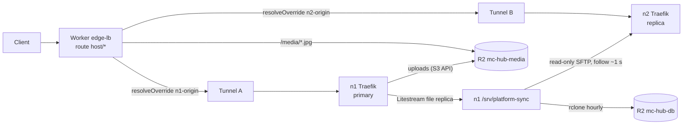

# Multi-node platform: edge load balancer, replicas, node bootstrap

Balanced apps (`replica_hosts` in `registry/<app>.yml`) run on several Oracle nodes; everything
else stays on its registry `host`. Only Cloudflare sits in between:



- **Routing** (`cloudflare/edge-lb/index.mjs`, rules from `registry/<app>.yml` `balance`):
  reads go to a node chosen by weighted rendezvous hashing of the client IP
  (`hosts/<node>.yml` `edge.weight`; lower on a node that also runs unbalanced services), so a
  client always lands on the same node and nodes share clients by weight. A 5xx (a read's 500
  too; a node that does not route the site yet answers 503, `edge/dynamic/zz-unrouted.yml`), a
  connect failure or no response headers within 1 s is retried once on the next node and
  (except a 500) marks the failed node last for 30 s. When every node failed, a stale edge copy
  is served, else the first node that only ran out of time is waited for. A `primary_paths` read waits for the
  writer instead (a replica refuses `/api/dl`, and a download's headers wait while a file the
  writer lacks comes from R2). The cron's checks (every minute) put a
  node last for everyone while its last check failed, and a replica whose follower has not
  confirmed for 3 minutes that it is current (`peer.sh` sends `synced` with each renewal) while
  the writer renews; down nodes still serve when nothing else does. Writes (non-GET), `primary_paths`, `primary_cookies` and, for
  `sticky_seconds` after a write that returns content (not a 204 such as a view count), the same
  client go to the writer: the registry `host`, or with `lease` the node its Durable Object names
  (re-read every 30 s; see Failover). Reads among them (a signed-in admin's pages, a sticky
  client's) fail over like any read while the writer fails, never through the edge cache; writes
  do not (queued, or 503 `WRITER_UNAVAILABLE` JSON that the site shows while the reader keeps
  the text; the API's own JSON errors, such as a fenced writer's `READ_ONLY`, pass as they are).
  `fanout` repeats a request (the admin cache purge) on the other nodes after a delay.
  `X-Edge-Node: <id>` pins a read to one node, honoured only from a node's own IP (its
  `ssh.address`): the deploy probe (`lib/route.py`) uses it.
- **Edge features of leased sites** (mc-hub only):
  - `queue_paths` (views, compat and feedback votes: each counts once per reader, so a copy
    delivered twice changes nothing): while the writer answers 5xx or not at all, the write goes
    to Queue `edge-lb-writes` and the reader gets 202 `{"queued": true}`; the consumer replays it
    to the writer with backoff (30 s up to an hour, 100 tries; a 429 is retried too, since
    Traefik counts every replay against the Worker's address), signing the reader's address in
    `X-Edge-Replay` (Worker `REPLAY_KEY` = `edge-replay-key` in the mc-hub-api volume). Comments
    and feedback are not queued: their Turnstile token lasts 5 minutes and a copy would post twice.
  - `edge_cache`: GETs of the listed paths without the session cookie stay in the Cache API
    for `ttl_seconds` and are served stale for `stale_seconds` when every node fails; only
    responses marked `public` or `no-cache`. The key carries the lease's version, bumped after
    each `fanout` reached every node, so an admin's purge reaches every colo.
  - `immutable_paths` (`/_astro/`): served by the edge cache; a miss that a node answers 404
    (a deploy reaches the nodes one after another) is tried on the next node, and only 2xx
    is cached.
  - Cron every minute: `/healthz` of every site on every node, and whether the writer renewed
    the lease in the last 3 minutes; Telegram (Worker secrets `TELEGRAM_TOKEN`,
    `TELEGRAM_CHAT_ID`) after two failures in a row and on recovery, on a promotion, and when the
    writer is down but no replica may take over by itself (Failover).
  - `WRITE_LIMIT` (Workers rate limit, every site): a reader address gets 60 writes a minute per
    Cloudflare location, then 429 `RATE_LIMITED` with `Retry-After: 60` from the edge (readers
    peaked at 28). Node addresses are not limited; the API's per-endpoint throttles stay the
    real limits. Approximate, and addresses behind one carrier NAT share it.
  - Workers Analytics Engine dataset `edge_lb`, a point per request: node, method, outcome
    (origin, hit, stale, queued, unavailable, bucket, limited), status, milliseconds.
    `edge_lb.py --operation stats` sums the last hour (token: Account Analytics Read).
- **Edge WAF & Rulesets** (`cloudflare/tofu/rulesets.tf`, OpenTofu; Free plan: 5 custom rules and
  1 rate limiting rule per zone, no regex): what an origin refuses anyway stops at Cloudflare,
  before the Worker and the tunnels. `edge-probe-paths` on both zones blocks dotfiles (not
  `/.well-known/`), `*.php`, WordPress paths and self-announcing scanners (sqlmap, nuclei, …);
  on the site also `/internal` and every file type it never serves outside `/_astro/`,
  `/media/`, `/cdn-cgi/` and `/.well-known/`. `mc-hub-api-host` keeps both API hosts to GET/HEAD
  of `/healthz`, the one route Traefik keeps there (`tests/test_mc_hub_api.py` keeps the list
  equal to the adapter), plus lease POSTs from the nodes' own addresses (`hosts/*.yml`
  `ssh.address`); readers use the site's `/api/`, SSR the node's internal entrypoint.
  `mc-hub-methods` takes writes on the site only under `/api/` and `/admin`. The rate limiting
  rule `mc-hub-api-flood` blocks an address for 10 s after 150 `/api/` or `/healthz` requests in
  10 s at one Cloudflare location (verified bots exempt): looser than Traefik's per-visitor
  limit, so it only sheds floods. On thedemontuan.dev
  `edge-free-managed` runs Cloudflare's Free Managed Ruleset except on monitor./metrics;
  tuannguyenviet.site keeps its Free ruleset rule (OmniRoute hosts only) and API path rules.
  Traefik's limits and CrowdSec stay behind them. Blocks show in Security → Events.
- **Data**: SQLite stays single-writer on the primary. Litestream (`litestream/`) writes its WAL
  changes to a local directory; each replica follows it over read-only SFTP (`sync/`) into its
  own file, and mc-hub-api opens that read-only (`DB_ROLE` = engine `NODE_ROLE`, or the volume's
  `role` file after a failover; writes there return 503 `READ_ONLY`, but the Worker never sends
  them). A primary also refuses writes (503 `READ_ONLY`) once `writer-lease` in its volume is
  150 s old: `peer/` touches it every minute while the lease names the node and ages it at
  once when another node holds it, so a writer cut off from the lease stops before the edge may
  promote another (3 minutes); no such file, no fence (a node that never ran `peer/`). The
  primary mirrors that directory
  and `/data/backups` to R2 hourly; the mirror container never restarts by itself: `peer/` starts
  it only while the lease confirms the node as writer and stops it after three failed renewals,
  so an old primary back from a reboot cannot replace the new primary's R2 copy. `peer/` also
  writes `/data/backups/daily-<UTC date>.db` on the confirmed writer (VACUUM INTO, 14 kept on the
  node, every one in R2 and in OCI Object Storage, below). Replication makes no R2 requests: following R2 directly
  listed ~480 objects a minute (Class A, beyond the free tier). Uploads are written locally and
  to R2; a node missing a file fetches it from R2.
- **SSR** stays on the node: mc-hub calls `http://edge-traefik:8082` (entrypoint `internal`,
  router `mc-hub-api-internal`).
- **Per-node limits**: Traefik rate limits run per node; with client affinity a visitor's
  requests (except writes, which go to the primary) are seen by one node. `peer/`
  (`platform-peer.timer`, every minute) renews the node's lease first (Telegram after two failed
  renewals). On a replica it checks that
  the follower keeps up, including when the writer's SFTP cannot be read at all (the follower
  uses the same link), and restarts the follower on the lease writer when it follows another
  node; Telegram after two bad runs and on recovery. The fleet is `/etc/platform/nodes`
  (`<id> <ip> <ECDSA host key>`, written by `ansible/`).
- **One CrowdSec LAPI**, on the lease writer. Every node runs its own agent, AppSec, nftables and
  Traefik bouncers. On followers `crowdsec-lapi.service` forwards `172.31.254.1:8080` to the LAPI
  via SSH with a host-pinned, source-restricted key; no public LAPI port. Litestream follows
  `crowdsec.db` separately into `/var/lib/crowdsec/follow` so machine and bouncer registrations
  move with decisions. `platform-lapi.service` switches roles independently of the app DB. Peer
  checks the LAPI follower TXID; a missing restore cannot promote. Replication is asynchronous:
  the newest decisions or unbans might not yet have reached the promoted node.
- **Controller fencing**: only a writer heartbeat gets a local grant; the next writer waits out
  its predecessor's last 180 s lease. A separate systemd timer stops the old LAPI and controller
  when the 120 s boot-local grant expires, even if peer stops. Agents do not require this grant.
- **Unban once**: `cscli decisions delete -i <ip>` on the current LAPI, or the Telegram bot's unban; every
  node drops it within a minute and the controller takes the IP off Cloudflare.
- **No self-renewing bans**: the LAPI's first profile (`crowdsec/config/profiles.yaml`,
  `already_banned`) gives an IP that already has a ban no new one; the bouncer's own 403s used
  to re-ban it through `http-generic-403-bf`.
- **No ban for a missing User-Agent**: `crowdsec/config/appsec-configs/local-no-ua-scope.yaml` (AppSec config, listed in
  `acquis.d/appsec.yaml`) drops the hub's out-of-band `crowdsecurity/experimental-no-user-agent`:
  six header-less API reads banned the owner's network for 16 h. That network leaves through
  three ISPs, each address banned on its own, so the site failed for some connections only.
- **Controller** (`/opt/crowdsec-telegram-controller` on all nodes, no source repository: its releases
  are the source; change one with `deploy/install.py --check/--install --source <copy>`): it
  tracks LAPI decisions by id, so it pulls the stream with `dedup=false` (release
  `574071fe425d99ee`). LAPI's default deduplication hides a deleted ban while another ban on the
  same IP outlives it, and that ban then stayed on Cloudflare until it would have expired.

## Change weights, rules or nodes

Edit `hosts/*.yml` / `registry/*.yml`, then:

```sh
python3 cloudflare/edge_lb.py --operation render   # rewrites edge-lb/config.mjs; commit it
CLOUDFLARE_API_TOKEN=… CLOUDFLARE_ACCOUNT_ID=… python3 cloudflare/edge_lb.py --operation survey
CLOUDFLARE_API_TOKEN=… CLOUDFLARE_ACCOUNT_ID=… python3 cloudflare/edge_lb.py --operation apply
```

`apply` creates the queue, uploads the Worker with its bindings (R2, Durable Object, queue,
Analytics Engine; secrets are kept), its queue consumer and cron, and only then sets the routes
(fail-open, Workers Paid); DNS and tunnels are OpenTofu's (`cloudflare/tofu`). Token: Workers
Scripts Edit, Workers Routes Edit, Queues Edit, Zone Read. Worker secrets, once: `NODE_KEY` (also each node's `/etc/platform/edge-node-key`),
`REPLAY_KEY` (also `edge-replay-key` in each node's mc-hub-api volume, owner 1000, 0600: a
runtime.env key would change the containers' environment, which a release upgrade refuses),
`TELEGRAM_TOKEN`, `TELEGRAM_CHAT_ID` (`PUT .../workers/scripts/edge-lb/secrets`). Drain a node
with `weight: 0` (it still takes retries and pinned probes).

## Balance another app

1. Its routes must work on every node (same Traefik bindings in each `hosts/<node>.yml`).
2. State must be shared: a database writer only on `host` (read-only replica elsewhere, as
   mc-hub-api), files in R2; anything else in memory or on disk is per node.
3. Add `replica_hosts` and `balance` to `registry/<app>.yml`, render, release, install the app
   on the new hosts (below), point its caller workflow at every host (`host` first), apply.

## Add a node

`hosts/<host>.yml` is the inventory; `ansible/` gives every node the same platform layer
(packages, CrowdSec, networks, edge stack, sync, Litestream, peer, monitoring agent, deploy
engine prerequisites) from this repository. Run it from the operator workstation (ssh-agent with
the nodes' `opc` keys); CI only lints it.

1. **Instance**: Oracle Linux 9 or 10 (ARM), ingress only SSH 22 (security list and firewalld).
   Grow the boot volume (`oci-growfs -y`). Record the ed25519 host key from the OCI console
   serial log, not from a first connection. Oracle reclaims idle Always Free instances (over 7
   days, 95th-percentile CPU, network and A1 memory all under 20 %): keep the node in use, or
   upgrade its tenancy to Pay As You Go (Always Free resources stay free).
2. **Cloudflare** (dashboard): the node's IP in the IP filter of the account tokens
   `litestream-mc-hub-db` and `mc-hub-media-nodes` (R2 backups and media; the litestream role
   fails on a node they refuse). Its tunnel `shared-edge-<host>` comes from `cloudflare/tofu`.
3. **Registry**: `hosts/<host>.yml` with `ssh` (address, port, fingerprint and `host_key`),
   `traefik`, `edge` (`id`, `tunnel`, `weight: 0`) and the balanced apps' bindings as on the
   other nodes; the host in each balanced app's `replica_hosts`; render.
4. **Platform**, from `ansible/` (the API token reads the new tunnel's token: Cloudflare Tunnel
   Read):

   ```sh
   export CLOUDFLARE_API_TOKEN=… CLOUDFLARE_ACCOUNT_ID=…
   ansible-playbook site.yml --check --diff   # every node: the new one appears in their fleet files
   ansible-playbook site.yml
   ```

   Shared secrets (alert bot, the Worker's `NODE_KEY`, R2 keys, origin certificates, the
   monitoring service token, GHCR login, app runtime env) are copied from `secrets_source`
   (`group_vars/edge.yml`) to a node that lacks them, never overwritten and never on the
   workstation; the sync and LAPI tunnel keys are generated on the node, its CrowdSec agent and
   bouncer keys on the LAPI node. Within a
   minute `peer.sh` starts `platform-role.service`, which follows the lease writer: the first
   `docker logs litestream` line is `entering follow mode`.
5. **Apps**: start `<app>-blue` from the release's Compose profile with the primary's current
   image and `NODE_ROLE=replica`, publish the adapter-rendered route (slot `blue`, a new
   generation). Installer `--check`, then apply, with `--host <host>` and the same deploy public
   key (`install/README.md`); `restorecon -R` the release.
6. `cloudflare/edge_lb.py --operation apply` with the new node's weight at 0 first (pinned probes
   only), then `deployctl adopt --app <app>` on the node,
   `systemctl enable --now vps-deploy-drain@<app>.timer`, and apply again with the real weight.
   Add the host to the app's caller workflow (after the primary host).

The monitoring hub (`monitor_hub: true`, n1) keeps its own `/etc/platform/monitor.env` (below);
Ansible writes only the agents', from n1's `/etc/platform/monitor-agent.env` (NODE, METRICS_URL,
remoteWrite_headers). Changing any node's platform files: edit them here, then the
same two commands (`--limit <host>` for one node). App routes in `/opt/platform/edge/dynamic`
belong to the deploy engine and are never touched.

## Fleet monitoring (replaced Beszel)

<https://monitor.thedemontuan.dev> (Cloudflare Access email login; Grafana trusts the Access JWT,
no second password), dashboard **Fleet**:

- **Edge routing**: requests, p95 and errors per node from edge-lb's Analytics Engine dataset,
  and a node × outcome × host table (`origin`, `hit`, `stale`, `queued`, `bucket`).
- **Lease and roles**: the lease writer as each node last saw it, primary/replica per node,
  whether the last lease renewal worked, replica lag in transactions (from `peer.sh`).
- **Nodes**: CPU, memory, disk, network, load, which scrape targets are up.
- **Containers**: memory and CPU per container (cAdvisor).
- **Traefik**: requests, 5xx and p95 per service on each node: what actually reached the node.

How it fits together (`platform/monitor/compose.yml`):

- Every node runs the `agent` profile: node-exporter, cAdvisor and vmagent, which scrapes them
  and Traefik every 30 s, labels everything `node=<NODE>` and pushes it to the hub, buffering up
  to 1 GB on disk while the hub is unreachable.
- The hub (n1, the strongest node) also runs `hub`: VictoriaMetrics (90 days) and Grafana. Its own vmagent writes to
  `127.0.0.1:8428`; the others push to `metrics.thedemontuan.dev` (n1's tunnel, Access app
  "Fleet Metrics Ingest": service token `monitor-vmagent` only, expires 2027-11-25), whose
  Traefik route only accepts `POST /api/v1/write`. The hub's `/etc/platform/monitor.env` (root
  0600, written by hand before `ansible/` runs there: it stops otherwise) is `NODE`,
  `METRICS_URL=http://127.0.0.1:8428/api/v1/write`, `CF_ACCOUNT_ID`, `CF_ANALYTICS_TOKEN` (user
  token `grafana-analytics-read`: Account Analytics Read, IP-filtered to the hub) and
  `ACCESS_AUD` (the Grafana Access app's AUD). The hub is one node: while it is down Grafana is
  down and the other agents buffer up to 1 GB and send it once it is back; its VictoriaMetrics
  data lives only on its disk. Moving the hub: `monitor_hub` in `host_vars`, the hub env on the
  new node, the `monitor`/`metrics` ingress and CNAMEs in `cloudflare/tofu`, the analytics
  token's IP filter; copy the `monitor_victoriametrics` volume with VictoriaMetrics stopped.
- Traefik on each node: a `metrics` entrypoint `:8899` with `metrics.prometheus` (entryPoint
  `metrics`, `addServicesLabels`), published only on `127.0.0.1:18082`. On the hub Traefik also
  joins `edge-monitor`, and `platform/monitor/traefik-monitor.yml` is
  `/opt/platform/edge/dynamic/monitor.yml`. Drain the node (weight 0) before recreating Traefik.
- CrowdSec: `dynamic/crowdsec.yml` on every node has `excludedHosts: [monitor.thedemontuan.dev,
  metrics.thedemontuan.dev]`. AppSec reads Grafana's query bodies (Analytics Engine SQL) and
  vmagent's binary remote-write bodies as SQL injection / HTTP violations and banned the owner's
  IP; both hosts only take requests Access already let through.
- Another node: `ansible/` (agent); it shows up in every panel by its `NODE`. Moving the hub: a new
  `grafana-analytics-read` token for the new hub's IP, tunnel ingress for both hostnames on the
  new hub's tunnel, the other nodes' `METRICS_URL` unchanged.

Not covered: logs (still `docker logs` on each node) and alert rules (alerts stay with the edge
cron, `peer.sh` and CrowdSec on Telegram; UptimeFlare checks Grafana's `/api/health`).

## Publish content (mc-hub `import`)

From the operator's machine, with the `vps-node-*` ssh aliases:

```sh
platform/mchub-import.sh path/to/bundle   # content.json + the files it names
```

It imports once, on the node that is both the lease writer and a running primary (refusing
while nodes disagree, mid-failover), then waits until every reachable replica's Litestream copy
has it. Nothing else is copied by hand: the files go to R2 during the import and the other nodes
read them from there. A replica refuses `import` by itself (read-only database). Pages show the
change within about 5 minutes (each node's page cache).

## Failover (the writer is down)

Reads keep working without action (the Worker retries the other nodes), readers' counters are
queued at the edge, comments and other writes get 503 `WRITER_UNAVAILABLE` for a few minutes.
The edge hands the lease to another node by itself once the writer has failed 3 cron checks in
a row (both its sites count) or stopped renewing the lease for 3 minutes (it fenced itself after
150 s, so it no longer writes). It picks the healthy replica that renewed within 3 minutes, whose
follower last confirmed it current at most 2 minutes before the writer's last good check, and
that is at most 5 Litestream transactions behind the position the writer last reported (each
renewal carries the node's position); among those, the one with the most data, then the highest
weight. When none qualifies, nothing changes and one Telegram says so; a person then decides.
That node's next `peer/` run promotes it as below. By hand, on a replica:

```sh
sudo /opt/platform/peer/role.sh promote          # refused while the writer still renews
sudo /opt/platform/peer/role.sh promote --force  # the writer is up but must stop writing
```

The lease names this node; every colo sends writes here within 30 s, and the node keeps following
the old primary for 35 s first, so writes a still-running old writer accepted in that window are
kept (writes here return 503 `READ_ONLY` meanwhile). The old writer refuses writes from its next
`peer/` run (a minute at most), or 150 s after its last renewal when it cannot reach the
lease. The node then starts Litestream as primary with a new lineage from its copy (writes the
old primary had not replicated, normally about a second, are lost), writes `role` and a fresh
`writer-lease` into the mc-hub-api volume and restarts mc-hub-api, which then opens the database
writable. The mirror replaces the R2 copy with the new lineage within the hour. The old primary,
once it renews again, sees it lost the lease: `platform-role.service` stops its Litestream,
mirror and mc-hub-api, moves its database to `fenced-<time>/` in the volume (what it never
replicated stays there), follows the new primary and starts mc-hub-api read-only. If that
restore does not finish within 5 minutes, mc-hub-api stays stopped and the next `peer/` run tries
again (`/var/lib/platform-peer/stopped-apps` lists what to start). Switches never overlap
(`/run/platform-role.lock`). Promote it back the same way.

With write quorum enabled, the recorded floor (epoch and transaction ID of the last acknowledged
write) replaces the lag tolerance above. Even a forced promotion must cover that floor. During
promotion `/var/lib/platform-peer/promoting` records the lease epoch: the timer resumes a failed
Litestream start or API restart without discarding that database or its new replication files.
Do not delete the marker to force a different epoch. Run `bash platform/peer/role.test.sh` from
the repository root to exercise recovery and credential permissions without accessing any node.

While the lease itself cannot be reached (the Worker down, every renewal failing), no node may
write: the writer fences itself after 150 s and nobody can take over until renewals work.

Inspect `writer` and `lapi` in `/var/lib/platform-peer` on every surviving node. Exactly one
should say `lapi=here` and run `crowdsec-telegram-controller`; others name that node and their
`cscli lapi status` must authenticate. Check both add and delete with a short TEST-NET decision,
not a real visitor. Never enable a second controller to work around a missing grant.

The deploy engine still follows the registry: until `host` and `replica_hosts` are swapped in
the balanced apps' registries (render, release, `edge_lb.py --operation apply`), mc-hub-api's
pre-release backup on the old `host` fails and stops its deploys; the `role` file keeps each
node's role across deploys either way.

## Restore from R2 (every node lost)

The mirror is a plain Litestream S3 replica. With the R2 token (IP-filtered to the nodes: add a
new node's IP first), a config `{dbs: [{path: /out/mc-hub.db, replica: {type: s3, bucket:
mc-hub-db, path: litestream/mc-hub-api, endpoint: https://<account>.r2.cloudflarestorage.com,
region: auto}}]}` and `litestream restore -config … /out/mc-hub.db` rebuild the database as of
the last hourly mirror; `r2:mc-hub-db/backups` holds `/data/backups` (the pre-release
`VACUUM INTO` snapshots).

Without Cloudflare: the confirmed writer also uploads each daily copy to the OCI bucket
`mc-hub-db-backup` (n1's tenancy; Object Storage console → the bucket → Objects → Download).
Setup, once, before the next platform run: a Standard bucket with Object Versioning on; a
pre-authenticated request for the bucket, "Permit object writes" only (no listing), expiring
years out; its URL (ending in `/o/`) in `/etc/platform/oci-backup-url` on the secrets source,
root 0600, which the run copies to every node. About 30 requests a month (50,000 free).
