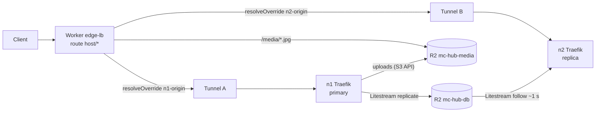

# Multi-node platform: edge load balancer, replicas, node bootstrap

Balanced apps (`replica_hosts` in `registry/<app>.yml`) run on several Oracle nodes; everything
else stays on its registry `host`. Only Cloudflare sits in between:



- **Routing** (`cloudflare/edge-lb/index.mjs`, rules from `registry/<app>.yml` `balance`):
  reads go to a node picked by weight (`hosts/<node>.yml` `edge.weight`; lower on a node that
  also runs unbalanced services); a 5xx/connect failure is retried once on the next node and
  marks the failed node last for 30 s. Writes (non-GET), `primary_paths`, `primary_cookies`
  and, for `sticky_seconds` after a write, the same client go to the primary (registry `host`).
  `fanout` repeats a request (the admin cache purge) on the other nodes after a delay.
  `X-Edge-Node: <id>` pins a read to one node: the deploy probe uses it (`lib/route.py`).
- **Data**: SQLite stays single-writer on the primary. Litestream (`litestream/`) ships its WAL
  to R2; each replica follows into its own file and mc-hub-api opens it read-only
  (`DB_ROLE` = engine `NODE_ROLE`; writes there return 503 `READ_ONLY`, but the Worker never
  sends them). Uploads are written locally and to R2; a node missing a file fetches it from R2.
- **SSR** stays on the node: mc-hub calls `http://edge-traefik:8082` (entrypoint `internal`,
  router `mc-hub-api-internal`).
- Per-node limits: Traefik rate limits and CrowdSec run per node, so a visitor's budget is
  per node (about doubled with two nodes). CrowdSec runs standalone on each node.

## Change weights, rules or nodes

Edit `hosts/*.yml` / `registry/*.yml`, then:

```sh
python3 cloudflare/edge_lb.py --operation render   # rewrites edge-lb/config.json; commit it
CLOUDFLARE_API_TOKEN=… CLOUDFLARE_ACCOUNT_ID=… python3 cloudflare/edge_lb.py --operation survey
CLOUDFLARE_API_TOKEN=… CLOUDFLARE_ACCOUNT_ID=… python3 cloudflare/edge_lb.py --operation apply
```

`apply` adds `<id>-origin.<zone>` CNAMEs, each node's tunnel ingress, uploads the Worker with
its R2 bindings and only then sets the routes (fail-open, Workers Paid). Token: Workers Scripts
Edit, Workers Routes Edit, Cloudflare Tunnel Edit, DNS Edit, Zone Read. Drain a node with
`weight: 0` (it still takes retries and pinned probes).

## Balance another app

1. Its routes must work on every node (same Traefik bindings in each `hosts/<node>.yml`).
2. State must be shared: a database writer only on `host` (read-only replica elsewhere, as
   mc-hub-api), files in R2; anything else in memory or on disk is per node.
3. Add `replica_hosts` and `balance` to `registry/<app>.yml`, render, release, install the app
   on the new hosts (below), point its caller workflow at every host (`host` first), apply.

## Bootstrap a node (as done for oracle-sg2 / n2)

1. **Instance**: Oracle Linux, ingress only SSH 22 (security list and firewalld). Grow the boot
   volume (`oci-growfs -y`). Record the host key fingerprint from the OCI console serial log,
   not from a first connection.
2. **Docker + CrowdSec**: Docker CE, CrowdSec and `crowdsec-firewall-bouncer-nftables` with
   `/etc/crowdsec` copied from n1 (standalone LAPI on `172.31.254.1:8080`, AppSec `:7422`; add
   the node's own IP to the whitelist), bouncers `cs-firewall-bouncer-<node>` and `traefik`
   (key in `/opt/platform/edge/secrets/crowdsec-bouncer-key`, root 0600),
   `crowdsec-endpoint-guard.service` enabled.
3. **Networks** (same addressing as n1): `edge-crowdsec` 172.31.254.0/28 internal,
   `edge-cf-ingress` 172.31.250.0/28 internal, `edge-egress` 172.31.252.0/28, and each balanced
   app's edge network (`edge-mc-hub` 172.25.0.0/16, `edge-mc-hub-api` 172.27.0.0/16 internal).
4. **Edge stack**: copy `/opt/platform/edge` from n1 without `secrets/` and app routes
   (`certs`, `cloudflare-ca`, `plugins-local`, `haproxy.cfg.template`, `dynamic/00-tls-origin.yml`,
   `middlewares.yml`, `crowdsec.yml`), keep only the balanced apps' networks in `compose.yml`,
   add `edge/internal.yml` and the `internal` entrypoint to `traefik.yml`:

   ```yaml
     web:
       # … unchanged …
       asDefault: true        # routers without entryPoints never land on "internal"
     slot-probe:
       address: "127.0.0.1:18080"
       asDefault: true
     internal:
       address: ":8082"
       http:
         middlewares: [internal-only@file]
   ```

   Create the node's tunnel (`shared-edge-<host>`, remotely managed), write its token to
   `secrets/tunnel-token` (opc 0600), `docker compose up -d`, enable `traefik-logrotate.timer`.
5. **Registry**: `hosts/<host>.yml` (ssh pin, traefik, `edge`, apps), the host in each app's
   `replica_hosts`, render; release.
6. **Data**: `docker volume create mc-hub-api-data`, then
   `docker run --rm -v mc-hub-api-data:/data busybox chown 1000:1000 /data`; write
   `/etc/platform/litestream.env` (root 0600) and start the follower from `platform/litestream`
   (`--profile replica`). Wait for `follow: applied updates` in `docker logs litestream`.
7. **Apps**: installer `--check`, then apply, for each balanced app with `--host <host>` and the
   same deploy public key; `runtime.env` as on the primary (mc-hub-api: `TURNSTILE_*`,
   `MEDIA_S3_*`). Stage `<app>-blue` from the release's Compose profile, publish the adapter
   route, `deployctl adopt --app <app>`. Add the host to the app's caller workflow.
8. `cloudflare/edge_lb.py --operation apply`.

## Promote a replica (the primary is gone for good)

Reads keep working without action (the Worker retries the other node); writes fail until this
is done. In one platform release: swap `host` and `replica_hosts` in the balanced apps'
registries, render. Stop Litestream on the old primary if it still runs. On the new primary:
stop the follower, change `path` in `litestream/litestream.yml` and the replica URL to a new
prefix (a new lineage; the old one stays as a backup), start `--profile primary`, redeploy
mc-hub-api (it now gets `NODE_ROLE=primary`), then `edge_lb.py --operation apply`.
Replicas restart their follower on the new prefix.
