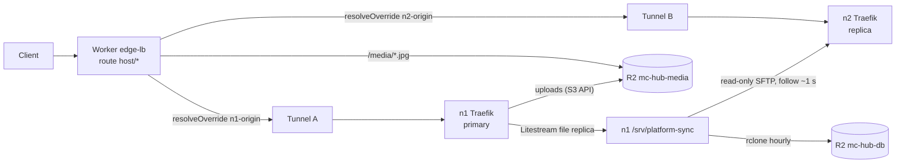

# Multi-node platform: edge load balancer, replicas, node bootstrap

Balanced apps (`replica_hosts` in `registry/<app>.yml`) run on several Oracle nodes; everything
else stays on its registry `host`. Only Cloudflare sits in between:



- **Routing** (`cloudflare/edge-lb/index.mjs`, rules from `registry/<app>.yml` `balance`):
  reads go to a node chosen by weighted rendezvous hashing of the client IP
  (`hosts/<node>.yml` `edge.weight`; lower on a node that also runs unbalanced services), so a
  client always lands on the same node and nodes share clients by weight. A 5xx, a connect
  failure or no response headers within 10 s is retried once on the next node and marks the
  failed node last for 30 s. Writes (non-GET), `primary_paths`, `primary_cookies` and, for
  `sticky_seconds` after a write, the same client go to the writer: the registry `host`, or with
  `lease` the node its Durable Object names (re-read every 30 s; see Failover).
  `fanout` repeats a request (the admin cache purge) on the other nodes after a delay.
  `X-Edge-Node: <id>` pins a read to one node, honoured only from a node's own IP (its
  `ssh.address`): the deploy probe (`lib/route.py`) uses it.
- **Edge features of leased sites** (mc-hub only):
  - `queue_paths` (views, comments, compat and feedback votes, feedback): while the writer
    answers 5xx or not at all, the write goes to Queue `edge-lb-writes` and the reader gets
    202 `{"queued": true}`; the consumer replays it to the writer with backoff (30 s up to an
    hour, 100 tries), signing the reader's address in `X-Edge-Replay` (Worker `REPLAY_KEY` =
    `edge-replay-key` in the mc-hub-api volume). Comments and feedback carry a Turnstile token
    that expires after 5 minutes: those are dropped (a 4xx) if the writer stays down longer.
  - `edge_cache`: GETs of the listed paths without the session cookie stay in the Cache API
    for `ttl_seconds` and are served stale for `stale_seconds` when every node fails; only
    responses marked `public` or `no-cache`. The key carries the lease's version, bumped after
    each `fanout` reached every node, so an admin's purge reaches every colo.
  - `immutable_paths` (`/_astro/`): served by the edge cache; a miss that a node answers 404
    (a deploy reaches the nodes one after another) is tried on the next node, and only 2xx
    is cached.
  - Cron every minute: `/healthz` of every site on every node, and whether the writer renewed
    the lease in the last 3 minutes; Telegram (Worker secrets `TELEGRAM_TOKEN`,
    `TELEGRAM_CHAT_ID`) after two failures in a row and on recovery.
  - Workers Analytics Engine dataset `edge_lb`, a point per request: node, method, outcome
    (origin, hit, stale, queued, bucket), status, milliseconds.
    `edge_lb.py --operation stats` sums the last hour (token: Account Analytics Read).
- **Data**: SQLite stays single-writer on the primary. Litestream (`litestream/`) writes its WAL
  changes to a local directory; each replica follows it over read-only SFTP (`sync/`) into its
  own file, and mc-hub-api opens that read-only (`DB_ROLE` = engine `NODE_ROLE`, or the volume's
  `role` file after a failover; writes there return 503 `READ_ONLY`, but the Worker never sends
  them). The primary mirrors that directory
  and `/data/backups` to R2 hourly. Replication makes no R2 requests: following R2 directly
  listed ~480 objects a minute (Class A, beyond the free tier). Uploads are written locally and
  to R2; a node missing a file fetches it from R2.
- **SSR** stays on the node: mc-hub calls `http://edge-traefik:8082` (entrypoint `internal`,
  router `mc-hub-api-internal`).
- **Per-node limits**: Traefik rate limits and CrowdSec run per node; with client affinity a
  visitor's requests (except writes, which go to the primary) are seen by one node. `peer/`
  (`platform-peer.timer`, every minute) copies each node's HTTP bans to the other as
  `peer/<id>:<scenario>`, so the CrowdSec → Cloudflare controller on n1 puts them on the edge
  list. It also renews the node's lease and, on a replica, checks that the follower keeps up;
  Telegram after two bad runs and on recovery.
- **Unban once**: `cscli decisions delete -i <ip>` on either node, or the Telegram bot's unban
  on n1. The node that removed a copy names the peer's ban in its `unbans.json` (`copies.jq`;
  check with `bash platform/peer/copies.test.sh`), the peer drops it within about two minutes,
  the controller takes the IP off Cloudflare. Before this, the removed copy came straight back.
- **No self-renewing bans**: `crowdsec/platform-already-banned.yaml` (postoverflow whitelist) keeps
  an IP this node already bans from earning a new ban; the bouncer's own 403s used to re-ban it
  through `http-generic-403-bf`, and the peer copied that back.
- **Controller** (`/opt/crowdsec-telegram-controller` on n1, no source repository: its releases
  are the source; change one with `deploy/install.py --check/--install --source <copy>`): it
  tracks LAPI decisions by id, so it pulls the stream with `dedup=false` (release
  `574071fe425d99ee`). LAPI's default deduplication hides a deleted ban while another ban on the
  same IP outlives it, and that ban then stayed on Cloudflare until it would have expired.

## Change weights, rules or nodes

Edit `hosts/*.yml` / `registry/*.yml`, then:

```sh
python3 cloudflare/edge_lb.py --operation render   # rewrites edge-lb/config.mjs; commit it
CLOUDFLARE_API_TOKEN=… CLOUDFLARE_ACCOUNT_ID=… python3 cloudflare/edge_lb.py --operation survey
CLOUDFLARE_API_TOKEN=… CLOUDFLARE_ACCOUNT_ID=… python3 cloudflare/edge_lb.py --operation apply
```

`apply` adds `<id>-origin.<zone>` CNAMEs, each node's tunnel ingress, the queue, uploads the
Worker with its bindings (R2, Durable Object, queue, Analytics Engine; secrets are kept), its
queue consumer and cron, and only then sets the routes (fail-open, Workers Paid). Token:
Workers Scripts Edit, Workers Routes Edit, Queues Edit, Cloudflare Tunnel Edit, DNS Edit, Zone
Read. Worker secrets, once: `NODE_KEY` (also each node's `/etc/platform/edge-node-key`),
`REPLAY_KEY` (also `edge-replay-key` in each node's mc-hub-api volume, owner 1000, 0600: a
runtime.env key would change the containers' environment, which a release upgrade refuses),
`TELEGRAM_TOKEN`, `TELEGRAM_CHAT_ID` (`PUT .../workers/scripts/edge-lb/secrets`). Drain a node
with `weight: 0` (it still takes retries and pinned probes).

## Balance another app

1. Its routes must work on every node (same Traefik bindings in each `hosts/<node>.yml`).
2. State must be shared: a database writer only on `host` (read-only replica elsewhere, as
   mc-hub-api), files in R2; anything else in memory or on disk is per node.
3. Add `replica_hosts` and `balance` to `registry/<app>.yml`, render, release, install the app
   on the new hosts (below), point its caller workflow at every host (`host` first), apply.

## Bootstrap a node (as done for oracle-sg2 / n2)

1. **Instance**: Oracle Linux, ingress only SSH 22 (security list and firewalld). Grow the boot
   volume (`oci-growfs -y`). Record the host key fingerprint from the OCI console serial log,
   not from a first connection. Oracle reclaims idle Always Free instances (over 7 days,
   95th-percentile CPU, network and A1 memory all under 20 %), which a lightly loaded replica is:
   install `keepalive/` (`platform-keepalive.service`, holds 1.5 GB resident) on a node under
   20 % memory, or upgrade its tenancy to Pay As You Go (Always Free resources stay free).
2. **Docker + CrowdSec**: Docker CE, CrowdSec and `crowdsec-firewall-bouncer-nftables` with
   `/etc/crowdsec` copied from n1 (standalone LAPI on `172.31.254.1:8080`, AppSec `:7422`; add
   every node's IP to `parsers/s02-enrich/03-self-whitelist.yaml` on every node: SFTP polling
   looks like `ssh-bf`), bouncers `cs-firewall-bouncer-<node>` and `traefik`
   (key in `/opt/platform/edge/secrets/crowdsec-bouncer-key`, root 0600),
   `crowdsec-endpoint-guard.service` enabled. `crowdsec/platform-already-banned.yaml` into
   `postoverflows/s01-whitelist/` (part of n1's `/etc/crowdsec` already).
3. **Networks** (same addressing as n1): `edge-crowdsec` 172.31.254.0/28 internal,
   `edge-cf-ingress` 172.31.250.0/28 internal, `edge-egress` 172.31.252.0/28, and each balanced
   app's edge network (`edge-mc-hub` 172.25.0.0/16, `edge-mc-hub-api` 172.27.0.0/16 internal).
4. **Edge stack**: copy `/opt/platform/edge` from n1 without `secrets/` and app routes
   (`certs`, `cloudflare-ca`, `plugins-local`, `haproxy.cfg.template`, `dynamic/00-tls-origin.yml`,
   `middlewares.yml`, `crowdsec.yml`), keep only the balanced apps' networks in `compose.yml`,
   add `edge/internal.yml` and the `internal` entrypoint to `traefik.yml`:

   ```yaml
     web:
       # … unchanged …
       asDefault: true        # routers without entryPoints never land on "internal"
     slot-probe:
       address: "127.0.0.1:18080"
       asDefault: true
     internal:
       address: ":8082"
       http:
         middlewares: [internal-only@file]
   ```

   Create the node's tunnel (`shared-edge-<host>`, remotely managed), write its token to
   `secrets/tunnel-token` (opc 0600), `docker compose up -d`, enable `traefik-logrotate.timer`.
5. **Registry**: `hosts/<host>.yml` (ssh pin, traefik, `edge`, apps), the host in each app's
   `replica_hosts`, render; release.
6. **Sync** (on every node, both directions): user `platform-sync`
   (`useradd -r -M -d /srv/platform-sync -s /sbin/nologin`), `/srv/platform-sync` and
   `/srv/platform-sync/crowdsec` root 0755, `/srv/platform-sync/litestream` 1000:1000 0755 with
   `setfacl -R -m u:platform-sync:rX` and the same `-d` default ACL (Litestream writes 0750
   directories); `sync/60-platform-sync.conf` in `/etc/ssh/sshd_config.d/` (root 0600),
   `sshd -t`, reload. This node's client key `/etc/platform/sync_key` (ed25519, owner 1000, 0600);
   its public key goes into each other node's `/etc/ssh/platform-sync.keys` as
   `restrict,from="<this node's IP>" ssh-ed25519 …`. `/etc/platform/known_hosts`: the other
   nodes' `<ip> ssh-ed25519 …` host keys, read over the pinned SSH session, not scanned.
   `restorecon -R /etc/ssh /srv/platform-sync /etc/platform`.
7. **Data**: `docker volume create mc-hub-api-data`, then
   `chown 1000:1000 "$(docker volume inspect -f '{{.Mountpoint}}' mc-hub-api-data)"`; write
   `/etc/platform/litestream.env` (root 0600) with `PRIMARY_SSH=<other node's ip>:22` and
   `PRIMARY_HOST_KEY=<its ecdsa-sha2-nistp256 host key>` (Litestream's SSH client negotiates
   ECDSA first and accepts only the pinned key; the primary has them too, for when it steps
   down), copy `platform/litestream` to `/opt/platform/litestream` and start the follower there
   (`--profile replica`). The first log line is `entering follow mode`.
8. **Peer**: copy `platform/peer` to `/opt/platform/peer`, the units to `/etc/systemd/system`,
   write `/etc/platform/peer.env` (`NODE`, `NODE_IP`, `PEER`, `PEER_IP`, `ROLE`,
   `LEASE_URL=https://api.thedemontuan.dev/__edge/lease/mc-hub-api`, `TELEGRAM_CHAT_ID`),
   `/etc/platform/telegram-token` (the CrowdSec controller's bot) and
   `/etc/platform/edge-node-key` (the Worker's `NODE_KEY`), both root 0600,
   `systemctl enable --now platform-peer.timer`. Create `/var/lib/node-exporter` (root 0755):
   each run writes the lease, role and replica lag there for the monitoring agent (step 11).
9. **Apps** (`dnf install git-core`; GHCR login in `/root/.docker/config.json` as on n1;
   `install/vps-deploy.conf` in `/etc/tmpfiles.d/`, else the engine's lock directory is gone
   after a reboot and every deploy and drain fails `UNTRUSTED_PATH`): put
   `runtime.env` content in `/opt/<app>/.env` (root 0600; mc-hub-api: `TURNSTILE_*`,
   `MEDIA_S3_*`), start `<app>-blue` from the release's Compose profile with the primary's
   current image and `NODE_ROLE=replica`, publish the adapter-rendered route (slot `blue`, a new
   generation). Installer `--check`, then apply, with `--host <host>` and the same deploy public
   key; `restorecon -R` the release.
10. `cloudflare/edge_lb.py --operation apply` with the new node's weight at 0 first (pinned probes
   only), then `deployctl adopt --app <app>` on the node,
   `systemctl enable --now vps-deploy-drain@<app>.timer`, and apply again with the real weight.
   Add the host to the app's caller workflow (after the primary host).
11. **Monitoring agent**: Traefik metrics (below), copy `platform/monitor` to
   `/opt/platform/monitor`, write `/etc/platform/monitor.env` (root 0600: `NODE`,
   `METRICS_URL=https://metrics.thedemontuan.dev/api/v1/write` and `remoteWrite_headers` with the
   `monitor-vmagent` service token), `docker compose --env-file /etc/platform/monitor.env
   --profile agent up -d`, then `chown 65534:65534` the `monitor_vmagent-buffer` volume's
   mountpoint (vmagent runs as nobody; Docker creates volumes root-owned) and restart
   `monitor-vmagent`. `restorecon -R /opt/platform/monitor /etc/platform`.

## Fleet monitoring (replaced Beszel)

<https://monitor.thedemontuan.dev> (Cloudflare Access email login; Grafana trusts the Access JWT,
no second password), dashboard **Fleet**:

- **Edge routing**: requests, p95 and errors per node from edge-lb's Analytics Engine dataset,
  and a node × outcome × host table (`origin`, `hit`, `stale`, `queued`, `bucket`).
- **Lease and roles**: the lease writer as each node last saw it, primary/replica per node,
  whether the last lease renewal worked, replica lag in transactions (from `peer.sh`).
- **Nodes**: CPU, memory, disk, network, load, which scrape targets are up.
- **Containers**: memory and CPU per container (cAdvisor).
- **Traefik**: requests, 5xx and p95 per service on each node: what actually reached the node.

How it fits together (`platform/monitor/compose.yml`):

- Every node runs the `agent` profile: node-exporter, cAdvisor and vmagent, which scrapes them
  and Traefik every 30 s, labels everything `node=<NODE>` and pushes it to the hub, buffering up
  to 1 GB on disk while the hub is unreachable.
- The hub (n2) also runs `hub`: VictoriaMetrics (90 days) and Grafana. Its own vmagent writes to
  `127.0.0.1:8428`; the others push to `metrics.thedemontuan.dev` (tunnel B, Access app
  "Fleet Metrics Ingest": service token `monitor-vmagent` only, expires 2027-11-25), whose
  Traefik route only accepts `POST /api/v1/write`. The hub's `/etc/platform/monitor.env` also
  holds `CF_ACCOUNT_ID`, `CF_ANALYTICS_TOKEN` (user token `grafana-analytics-read`: Account
  Analytics Read, IP-filtered to the hub) and `ACCESS_AUD` (the Grafana Access app's AUD).
- Traefik on each node: a `metrics` entrypoint `:8899` with `metrics.prometheus` (entryPoint
  `metrics`, `addServicesLabels`), published only on `127.0.0.1:18082`. On the hub Traefik also
  joins `edge-monitor`, and `platform/monitor/traefik-monitor.yml` is
  `/opt/platform/edge/dynamic/monitor.yml`. Drain the node (weight 0) before recreating Traefik.
- CrowdSec: `dynamic/crowdsec.yml` on every node has `excludedHosts: [monitor.thedemontuan.dev,
  metrics.thedemontuan.dev]`. AppSec reads Grafana's query bodies (Analytics Engine SQL) and
  vmagent's binary remote-write bodies as SQL injection / HTTP violations and banned the owner's
  IP; both hosts only take requests Access already let through.
- Another node: step 11 above; it shows up in every panel by its `NODE`. Moving the hub: a new
  `grafana-analytics-read` token for the new hub's IP, tunnel ingress for both hostnames on the
  new hub's tunnel, the other nodes' `METRICS_URL` unchanged.

Not covered: logs (still `docker logs` on each node) and alert rules (alerts stay with the edge
cron, `peer.sh` and CrowdSec on Telegram; UptimeFlare checks Grafana's `/api/health`).

## Publish content (mc-hub `import`)

From the operator's machine, with the `vps-node-*` ssh aliases:

```sh
platform/mchub-import.sh path/to/bundle   # content.json + the files it names
```

It imports once, on the node that is both the lease writer and a running primary (refusing
while nodes disagree, mid-failover), then waits until every reachable replica's Litestream copy
has it. Nothing else is copied by hand: the files go to R2 during the import and the other nodes
read them from there. A replica refuses `import` by itself (read-only database). Pages show the
change within about 5 minutes (each node's page cache).

## Failover (the writer is down)

Reads keep working without action (the Worker retries the other node), readers' writes are
queued at the edge, everything else that writes fails. The edge alerts once the writer has not
renewed its lease for 3 minutes. If it stays down, on the other node:

```sh
sudo /opt/platform/peer/role.sh promote          # refused while the writer still renews
sudo /opt/platform/peer/role.sh promote --force  # the writer is up but must stop writing
```

The lease names this node; within 30 s every colo sends writes here (and replays the queue
here). The node starts Litestream as primary with a new lineage from its copy (writes the old
primary had not replicated, normally about a second, are lost), writes `role` into the
mc-hub-api volume and restarts mc-hub-api, which then opens the database writable. The mirror
replaces the R2 copy with the new lineage within the hour. The old primary, once it renews again,
sees it lost the lease: `platform-role.service` stops its Litestream and mc-hub-api, moves its
database to `fenced-<time>/` in the volume, follows the new primary and starts mc-hub-api
read-only. Promote it back the same way.

The deploy engine still follows the registry: until `host` and `replica_hosts` are swapped in
the balanced apps' registries (render, release, `edge_lb.py --operation apply`), mc-hub-api's
pre-release backup on the old `host` fails and stops its deploys; the `role` file keeps each
node's role across deploys either way.

## Restore from R2 (every node lost)

The mirror is a plain Litestream S3 replica. With the R2 token (IP-filtered to the nodes: add a
new node's IP first), a config `{dbs: [{path: /out/mc-hub.db, replica: {type: s3, bucket:
mc-hub-db, path: litestream/mc-hub-api, endpoint: https://<account>.r2.cloudflarestorage.com,
region: auto}}]}` and `litestream restore -config … /out/mc-hub.db` rebuild the database as of
the last hourly mirror; `r2:mc-hub-db/backups` holds `/data/backups` (the pre-release
`VACUUM INTO` snapshots).
