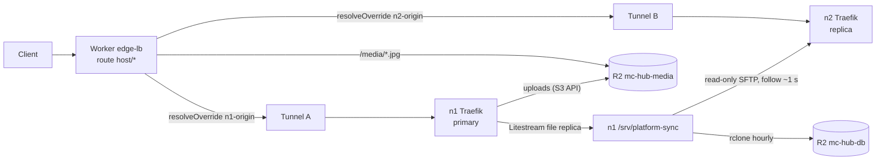

# Multi-node platform: edge load balancer, replicas, node bootstrap

Balanced apps (`replica_hosts` in `registry/<app>.yml`) run on several Oracle nodes; everything
else stays on its registry `host`. Only Cloudflare sits in between:



- **Routing** (`cloudflare/edge-lb/index.mjs`, rules from `registry/<app>.yml` `balance`):
  reads go to a node chosen by weighted rendezvous hashing of the client IP
  (`hosts/<node>.yml` `edge.weight`; lower on a node that also runs unbalanced services), so a
  client always lands on the same node and nodes share clients by weight. A 5xx, a connect
  failure or no response headers within 10 s is retried once on the next node and marks the
  failed node last for 30 s. Writes (non-GET), `primary_paths`, `primary_cookies` and, for
  `sticky_seconds` after a write, the same client go to the primary (registry `host`).
  `fanout` repeats a request (the admin cache purge) on the other nodes after a delay.
  `X-Edge-Node: <id>` pins a read to one node, honoured only from a node's own IP (its
  `ssh.address`): the deploy probe (`lib/route.py`) and `peer/` use it.
- **Data**: SQLite stays single-writer on the primary. Litestream (`litestream/`) writes its WAL
  changes to a local directory; each replica follows it over read-only SFTP (`sync/`) into its
  own file, and mc-hub-api opens that read-only (`DB_ROLE` = engine `NODE_ROLE`; writes there
  return 503 `READ_ONLY`, but the Worker never sends them). The primary mirrors that directory
  and `/data/backups` to R2 hourly. Replication makes no R2 requests: following R2 directly
  listed ~480 objects a minute (Class A, beyond the free tier). Uploads are written locally and
  to R2; a node missing a file fetches it from R2.
- **SSR** stays on the node: mc-hub calls `http://edge-traefik:8082` (entrypoint `internal`,
  router `mc-hub-api-internal`).
- **Per-node limits**: Traefik rate limits and CrowdSec run per node; with client affinity a
  visitor's requests (except writes, which go to the primary) are seen by one node. `peer/`
  (`platform-peer.timer`, every minute) copies each node's HTTP bans to the other as
  `peer/<id>:<scenario>`, so the CrowdSec → Cloudflare controller on n1 puts them on the edge
  list. It also checks the other node through the edge and, on a replica, that the follower keeps
  up; Telegram after two bad runs and on recovery.

## Change weights, rules or nodes

Edit `hosts/*.yml` / `registry/*.yml`, then:

```sh
python3 cloudflare/edge_lb.py --operation render   # rewrites edge-lb/config.mjs; commit it
CLOUDFLARE_API_TOKEN=… CLOUDFLARE_ACCOUNT_ID=… python3 cloudflare/edge_lb.py --operation survey
CLOUDFLARE_API_TOKEN=… CLOUDFLARE_ACCOUNT_ID=… python3 cloudflare/edge_lb.py --operation apply
```

`apply` adds `<id>-origin.<zone>` CNAMEs, each node's tunnel ingress, uploads the Worker with
its R2 bindings and only then sets the routes (fail-open, Workers Paid). Token: Workers Scripts
Edit, Workers Routes Edit, Cloudflare Tunnel Edit, DNS Edit, Zone Read. Drain a node with
`weight: 0` (it still takes retries and pinned probes).

## Balance another app

1. Its routes must work on every node (same Traefik bindings in each `hosts/<node>.yml`).
2. State must be shared: a database writer only on `host` (read-only replica elsewhere, as
   mc-hub-api), files in R2; anything else in memory or on disk is per node.
3. Add `replica_hosts` and `balance` to `registry/<app>.yml`, render, release, install the app
   on the new hosts (below), point its caller workflow at every host (`host` first), apply.

## Bootstrap a node (as done for oracle-sg2 / n2)

1. **Instance**: Oracle Linux, ingress only SSH 22 (security list and firewalld). Grow the boot
   volume (`oci-growfs -y`). Record the host key fingerprint from the OCI console serial log,
   not from a first connection. Oracle reclaims idle Always Free instances (over 7 days,
   95th-percentile CPU, network and A1 memory all under 20 %), which a lightly loaded replica is:
   install `keepalive/` (`platform-keepalive.service`, holds 1.5 GB resident) on a node under
   20 % memory, or upgrade its tenancy to Pay As You Go (Always Free resources stay free).
2. **Docker + CrowdSec**: Docker CE, CrowdSec and `crowdsec-firewall-bouncer-nftables` with
   `/etc/crowdsec` copied from n1 (standalone LAPI on `172.31.254.1:8080`, AppSec `:7422`; add
   every node's IP to `parsers/s02-enrich/03-self-whitelist.yaml` on every node: SFTP polling
   looks like `ssh-bf`), bouncers `cs-firewall-bouncer-<node>` and `traefik`
   (key in `/opt/platform/edge/secrets/crowdsec-bouncer-key`, root 0600),
   `crowdsec-endpoint-guard.service` enabled.
3. **Networks** (same addressing as n1): `edge-crowdsec` 172.31.254.0/28 internal,
   `edge-cf-ingress` 172.31.250.0/28 internal, `edge-egress` 172.31.252.0/28, and each balanced
   app's edge network (`edge-mc-hub` 172.25.0.0/16, `edge-mc-hub-api` 172.27.0.0/16 internal).
4. **Edge stack**: copy `/opt/platform/edge` from n1 without `secrets/` and app routes
   (`certs`, `cloudflare-ca`, `plugins-local`, `haproxy.cfg.template`, `dynamic/00-tls-origin.yml`,
   `middlewares.yml`, `crowdsec.yml`), keep only the balanced apps' networks in `compose.yml`,
   add `edge/internal.yml` and the `internal` entrypoint to `traefik.yml`:

   ```yaml
     web:
       # … unchanged …
       asDefault: true        # routers without entryPoints never land on "internal"
     slot-probe:
       address: "127.0.0.1:18080"
       asDefault: true
     internal:
       address: ":8082"
       http:
         middlewares: [internal-only@file]
   ```

   Create the node's tunnel (`shared-edge-<host>`, remotely managed), write its token to
   `secrets/tunnel-token` (opc 0600), `docker compose up -d`, enable `traefik-logrotate.timer`.
5. **Registry**: `hosts/<host>.yml` (ssh pin, traefik, `edge`, apps), the host in each app's
   `replica_hosts`, render; release.
6. **Sync** (on every node, both directions): user `platform-sync`
   (`useradd -r -M -d /srv/platform-sync -s /sbin/nologin`), `/srv/platform-sync` and
   `/srv/platform-sync/crowdsec` root 0755, `/srv/platform-sync/litestream` 1000:1000 0755 with
   `setfacl -R -m u:platform-sync:rX` and the same `-d` default ACL (Litestream writes 0750
   directories); `sync/60-platform-sync.conf` in `/etc/ssh/sshd_config.d/` (root 0600),
   `sshd -t`, reload. This node's client key `/etc/platform/sync_key` (ed25519, owner 1000, 0600);
   its public key goes into each other node's `/etc/ssh/platform-sync.keys` as
   `restrict,from="<this node's IP>" ssh-ed25519 …`. `/etc/platform/known_hosts`: the other
   nodes' `<ip> ssh-ed25519 …` host keys, read over the pinned SSH session, not scanned.
   `restorecon -R /etc/ssh /srv/platform-sync /etc/platform`.
7. **Data**: `docker volume create mc-hub-api-data`, then
   `chown 1000:1000 "$(docker volume inspect -f '{{.Mountpoint}}' mc-hub-api-data)"`; write
   `/etc/platform/litestream.env` (root 0600) with `PRIMARY_SSH=<primary ip>:22` and
   `PRIMARY_HOST_KEY=<primary's ecdsa-sha2-nistp256 host key>` (Litestream's SSH client
   negotiates ECDSA first and accepts only the pinned key), copy `platform/litestream` to
   `/opt/platform/litestream` and start the follower there (`--profile replica`). The first log
   line is `entering follow mode`.
8. **Peer**: copy `platform/peer` to `/opt/platform/peer`, the units to `/etc/systemd/system`,
   write `/etc/platform/peer.env` (`NODE`, `NODE_IP`, `PEER`, `PEER_IP`, `ROLE`,
   `CHECK_URLS="https://thedemontuan.dev/healthz https://api.thedemontuan.dev/healthz"`,
   `TELEGRAM_CHAT_ID`) and `/etc/platform/telegram-token` (the CrowdSec controller's bot, root
   0600), `systemctl enable --now platform-peer.timer`.
9. **Apps** (`dnf install git-core`; GHCR login in `/root/.docker/config.json` as on n1): put
   `runtime.env` content in `/opt/<app>/.env` (root 0600; mc-hub-api: `TURNSTILE_*`,
   `MEDIA_S3_*`), start `<app>-blue` from the release's Compose profile with the primary's
   current image and `NODE_ROLE=replica`, publish the adapter-rendered route (slot `blue`, a new
   generation). Installer `--check`, then apply, with `--host <host>` and the same deploy public
   key; `restorecon -R` the release.
10. `cloudflare/edge_lb.py --operation apply` with the new node's weight at 0 first (pinned probes
   only), then `deployctl adopt --app <app>` on the node,
   `systemctl enable --now vps-deploy-drain@<app>.timer`, and apply again with the real weight.
   Add the host to the app's caller workflow (after the primary host).

## Promote a replica (the primary is gone for good)

Reads keep working without action (the Worker retries the other node); writes fail until this
is done. In one platform release: swap `host` and `replica_hosts` in the balanced apps'
registries, render. Stop Litestream on the old primary if it still runs. On the new primary:
`--profile replica down`, empty `/srv/platform-sync/litestream` (keeping its ACLs), start
`--profile primary` (a new lineage, from its own copy of the database), redeploy mc-hub-api
(it now gets `NODE_ROLE=primary`), then `edge_lb.py --operation apply`. Within the hour the
mirror replaces the R2 copy with the new lineage; `rclone copy` the old prefix aside first to
keep it. On every replica: point `PRIMARY_SSH`/`PRIMARY_HOST_KEY` at the new primary, remove
`mc-hub.db`, `mc-hub.db-wal`, `mc-hub.db-shm` and `mc-hub.db-txid` from the volume, start
`--profile replica`. Swap `ROLE` in each node's `peer.env`.

## Restore from R2 (every node lost)

The mirror is a plain Litestream S3 replica. With the R2 token (IP-filtered to the nodes: add a
new node's IP first), a config `{dbs: [{path: /out/mc-hub.db, replica: {type: s3, bucket:
mc-hub-db, path: litestream/mc-hub-api, endpoint: https://<account>.r2.cloudflarestorage.com,
region: auto}}]}` and `litestream restore -config … /out/mc-hub.db` rebuild the database as of
the last hourly mirror; `r2:mc-hub-db/backups` holds `/data/backups` (the pre-release
`VACUUM INTO` snapshots).
